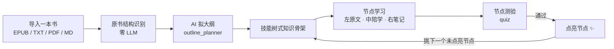

# BetterOneself

<p>
  
  
  
  
  
</p>

**陪你学透一本书的 Agent。**

导入一本书，看到技能树式的知识骨架；点开一个节点，进入「左原文、中陪学、右笔记」的学习；通过节点测验，点亮这盏灯——然后想点下一盏。

V0.1 是**单机、单用户、自导入**的验证版本，只验证一条最薄闭环：**「学习—考练—点亮」能否驱动一个人把一本书一章一章学下去**。计划、复习、卡片、掌握档案等已列入[后续候选](docs/v0.1/后续候选/)，不在本版范围。

## 核心闭环



## 特性

- **导入即有骨架**：目录识别不依赖 LLM；AI 拟大纲只做一次（总述、部分分组、排除/拆分/合并），章锚点保留——LLM 未配置或失败时保留原书目录树，不阻塞基础学习路径。
- **三栏学习界面**：左侧原文、中间 AI 陪学对话（`tutor` skill，讲解与追问围绕当前节点）、右侧个人笔记，学与记在同一屏。
- **测验与点亮**：本节点测验通过即点亮，通过线在测验前明示；点亮口径透明——当前通过 ≠ 长期记忆。
- **知识点是数据枢纽**：会话与测验通过知识点关联，而不是靠检索切片拼凑。
- **证据与数据不丢**：目录编辑不会静默删除会话、测验记录或点亮状态。
- **单机与隐私**：默认仅监听 `127.0.0.1`，无账号、无云端；LLM API Key 加密落库，日志与导出不含明文。
- **BYO-Key**：任何 OpenAI 兼容协议的模型服务均可，embedding 可独立配置。

## 快速开始

### 环境要求

- Python 3.12+ 与 [uv](https://docs.astral.sh/uv/)
- Node.js 20+ 与 pnpm
- 一个 OpenAI 兼容的 LLM API Key（不配置也可用原书目录学习，AI 功能不可用）

### 源码运行

```bash
# 后端（默认 http://127.0.0.1:8000，启动时自动完成数据库迁移）
cd backend
uv sync
uv run uvicorn app.main:app --reload

# 前端（另开终端，默认 http://localhost:5173）
cd frontend
pnpm install
pnpm dev
```

首次使用请在应用「设置」页填入 LLM 服务地址与 API Key——Key 加密保存在本机 `backend/data/`，不会出现在任何日志里。

### 构建 Windows 免安装版

```bash
cd backend
uv sync
uv run python scripts/build_exe.py
```

产物为 `backend/dist/BetterOneself/` 免安装文件夹：整个文件夹拷走即分发，双击 `BetterOneself.exe` 自动起服务并打开浏览器；关闭控制台窗口即停止服务，用户机零依赖。

## 配置

LLM 相关配置在应用内「设置」页完成。可选的服务器端环境变量均带 `BO_` 前缀：

| 环境变量 | 默认值 | 说明 |
|---|---|---|
| `BO_HOST` / `BO_PORT` | `127.0.0.1` / `8000` | 监听地址与端口 |
| `BO_DATA_DIR` | `backend/data/` | SQLite、上传文件、加密密钥的存放目录 |
| `BO_EXTRA_ALLOWED_ORIGINS` | 空 | 额外允许的前端来源（CORS），逗号分隔 |
| `BO_LLM_STUB` | `0` | 用确定性桩替代真实 LLM，供 E2E 与开发调试，不触网 |

## 技术栈

| 端 | 技术 |
|---|---|
| backend | Python 3.12 / FastAPI / SQLAlchemy 2 + SQLite（sqlite-vec）/ Alembic / Pydantic v2 / pypdf + BeautifulSoup4（文档解析）|
| frontend | React 19 / Vite / TypeScript strict / Tailwind CSS 4 + Radix UI / TanStack Query / React Router 7 |
| LLM | OpenAI 兼容协议 BYO-Key；embedding 独立配置；AI 按职责拆为 `outline_planner`（拟大纲）/ `tutor`（陪学）/ `quiz`（出题）三个 skill |

无 LangGraph、无编排框架——V0.1 会话为顺序流，刻意保持最薄。

## 项目结构

```
backend/    FastAPI 服务：api/ services/ models/ ingest/ skills/ + alembic 迁移 + 打包脚本
frontend/   React 应用：src/ + Playwright E2E（e2e/）
docs/       产品与技术文档（一等公民，动代码前先读）
qa/         测试交付物：用例、报告、缺陷台账、回归脚本
```

## 文档

这个仓库把文档当一等公民：先有评审后的产品与技术文档，再有代码。

| 类别 | 文档 |
|---|---|
| 产品 | [需求分析](docs/v0.1/product/需求分析.md) · [需求列表](docs/v0.1/product/需求列表.md) · [页面清单](docs/v0.1/product/页面清单.md) · [原型设计](docs/v0.1/product/原型设计.md) |
| 技术 | [技术方案](docs/v0.1/technical/技术方案.md) · [数据模型](docs/v0.1/technical/数据模型.md) · [流程图](docs/v0.1/technical/流程图.md) · [接口设计](docs/v0.1/technical/接口设计.md) |
| 决策与历史 | [决策记录](docs/v0.1/决策记录.md) · [注意事项](docs/v0.1/注意事项.md) · [后续候选](docs/v0.1/后续候选/) |

## 开发与测试

```bash
# 后端：单测 + 静态检查（ruff + mypy strict）
cd backend && uv run pytest && uv run ruff check . && uv run mypy app

# 前端：lint + 类型检查
cd frontend && pnpm lint && pnpm tsc --noEmit

# 端到端（Playwright，验证真实闭环与回跳、重考等结果）
cd frontend && pnpm e2e
```

测试纪律：核心算法单测必测；LLM 一律 mock 不花真 token；E2E 验证真实闭环。

## 路线图

V0.1 只做最薄闭环。已评估并延后的候选见 [docs/v0.1/后续候选/](docs/v0.1/后续候选/)，包括：计划与督促、复习与卡片、掌握档案与强度分级、学习增强、数据与导出、书籍分享。

明确不在范围内的：多用户账号、社区、跨书统一档案、通用技能平台。

## 贡献

当前为个人开发验证阶段，以自有节奏推进。欢迎开 issue 交流使用反馈与设计想法；PR 前请先通过 issue 讨论达成一致。

## License

[MIT](LICENSE) © 2026 王志发
