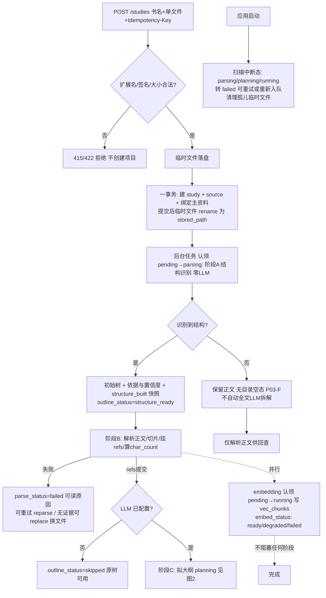
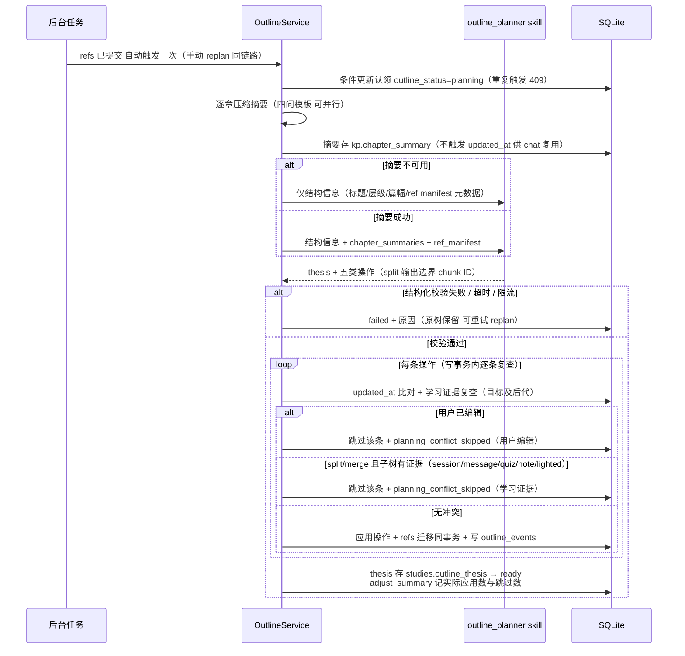
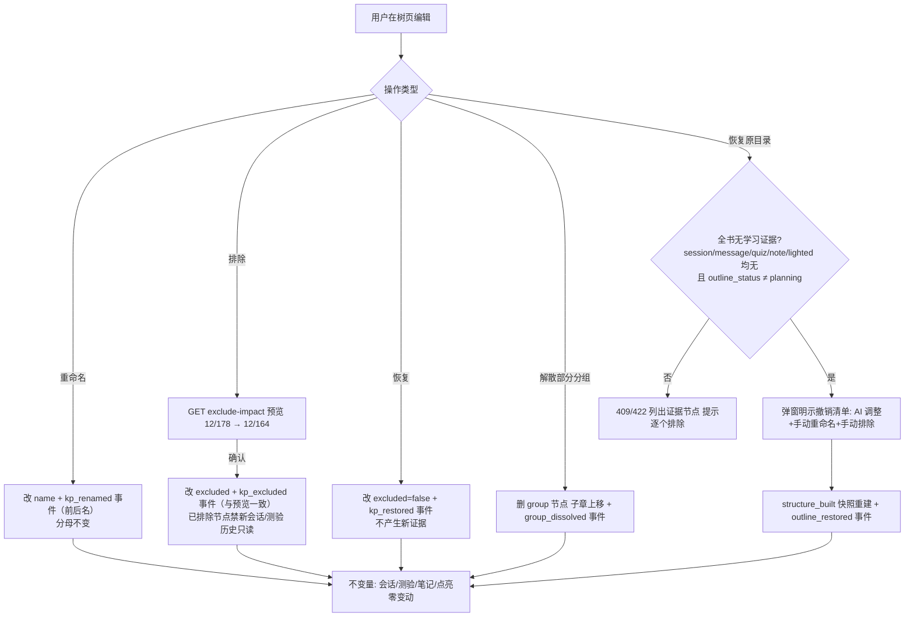
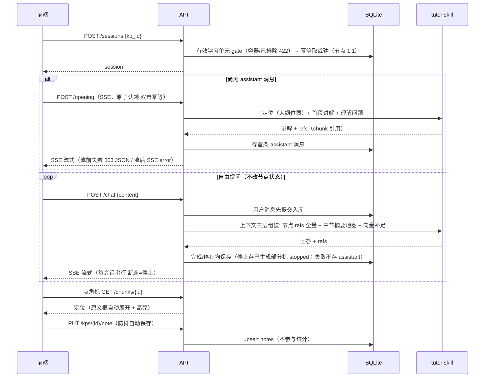
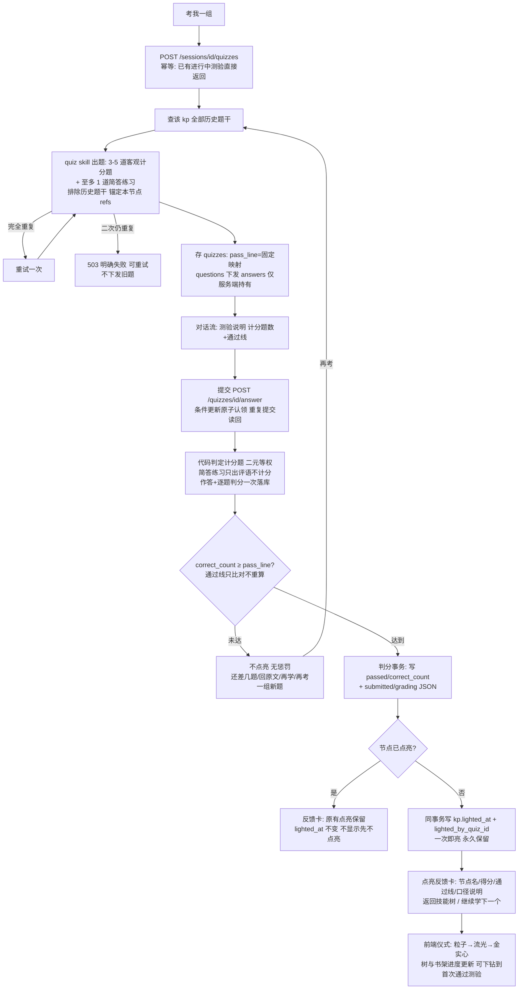
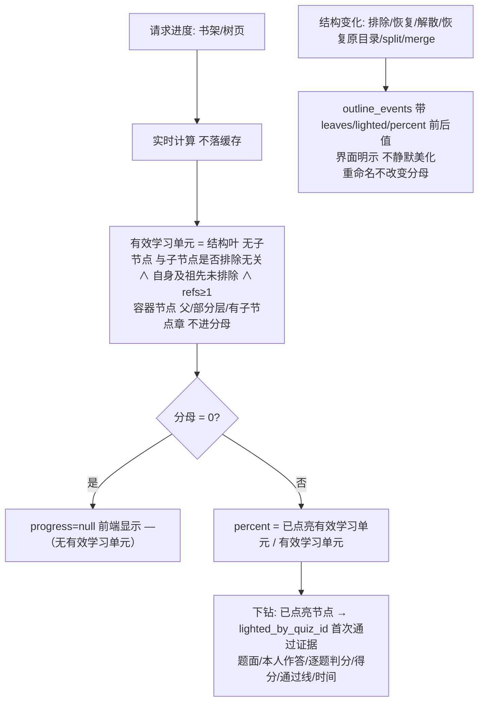

# V0.1 技术流程图

> 日期：2026-11-20｜状态：目标流程，未实施（代码已清零，随重建落地）
> 产品流程见 [需求分析](../product/需求分析.md)；本文只描述系统边界、状态与数据一致性。
> 配套：[技术方案](技术方案.md)、[数据模型](数据模型.md)、[接口设计](接口设计.md)

## 1. 导入：三阶段解耦（B1、B2-01～04）

边界：规划失败 ≠ 解析失败 ≠ 模型服务不可用，分别展示与重试；embedding 先完成或后完成不改变目录结果；任务认领用条件更新防双跑。

## 2. 拟大纲生成与应用（B2-03，决策 #25）

不变量：章不可删、不跨章合并、group 仅连续章节区间、失败不留半次结果、split 区间完整有序不重叠、merge 仅同父相邻结构叶、正文逐字不进上下文、证据子树不被破坏性操作触碰。

## 3. 目录编辑与证据保留（B2-05，决策 #6/21）

手动拆分、合并、移动、新增节点不在本版（决策 #21，见 [后续候选/学习增强](../后续候选/学习增强.md)）。

## 4. 学习会话（B3-01～04）

## 5. 测验与点亮（B4，核心闭环）

通过线为 service 固定映射 {3题:2, 4题:3, 5题:4}，生成时落库、判分只比对，三种学习方法一致；打开会话、阅读、自由提问、未通过测验都不写 `lighted_at`（B4-03 反例）。

## 6. 点亮进度计算（B5-01）

## 7. 状态归属表

| 状态 | 落点 | 说明 |
|---|---|---|
| 正文解析 | `sources.parse_status` | pending / parsing / parsed / failed；条件更新认领，启动恢复 |
| 目录规划 | `studies.outline_status` + `outline_error` | 与 parse_status 分别展示分别重试；planning 中学习与编辑不阻塞 |
| 向量 | `sources.embed_status` + `embed_error` | pending / running / ready / degraded / failed；失败只失去跨节点补足 |
| 结构变化 | `outline_events` | 识别 / AI 规划（含冲突跳过）/ 用户编辑全审计 |
| 学习单元与容器 | 派生：无子节点 + `excluded` + refs | 学习单元有三态；容器只显示聚合进度 |
| 节点学习态 | 派生：`lighted_at` + message/quiz 存在 | 未学 / 学习中 / 已点亮，不落字段 |
| 点亮 | `knowledge_points.lighted_at` + `lighted_by_quiz_id` | 一次写入永久保留；首次通过证据与最近测验分开 |
| 测验生命周期 | `quizzes.answered_at` + partial unique | 一节点一组进行中；生成与提交幂等 |
| 会话内容 | `messages` / `quizzes` | 对话流按 created_at 合并渲染；用户消息先落库、stopped 保存 |
| 服务配置 | `settings` | 密钥 Fernet 加密，响应只出掩码，PUT 缺省不变/null 清除/新值替换 |
| AI 用量 | `usage_days` | 写入失败不静默吞掉 |
