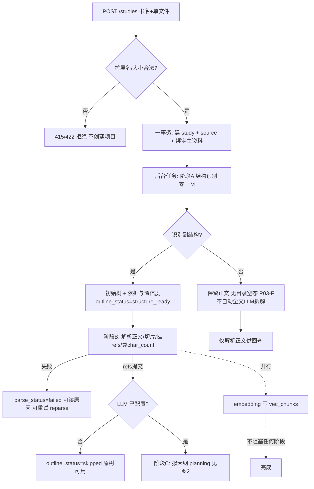
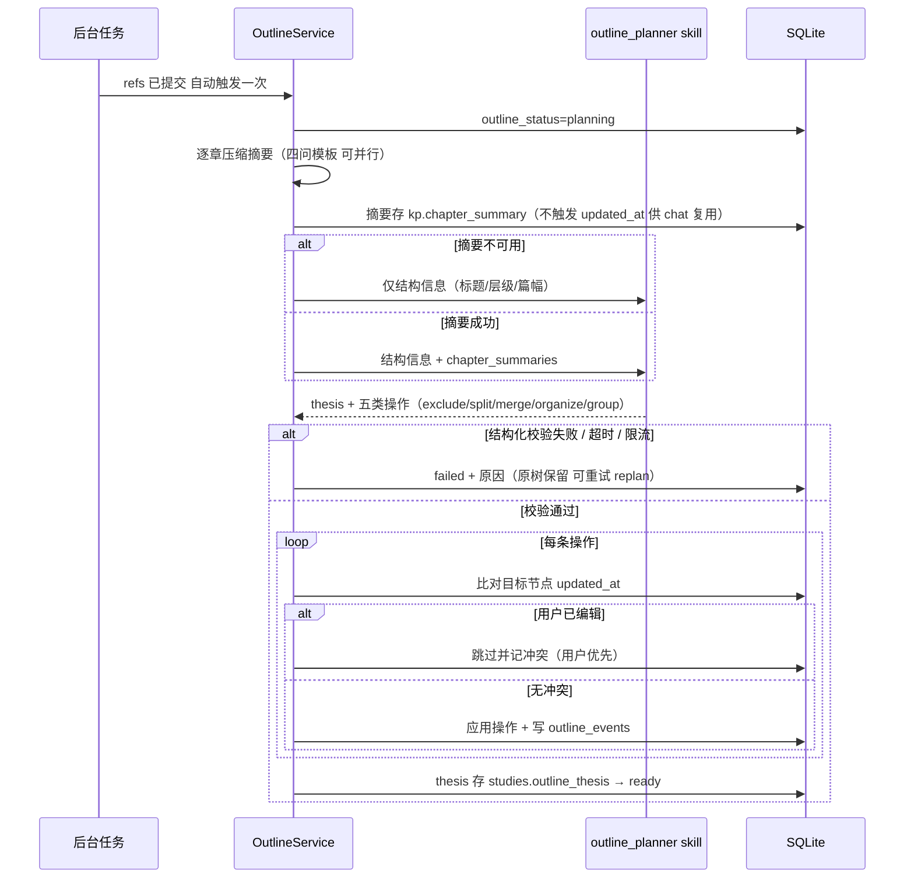
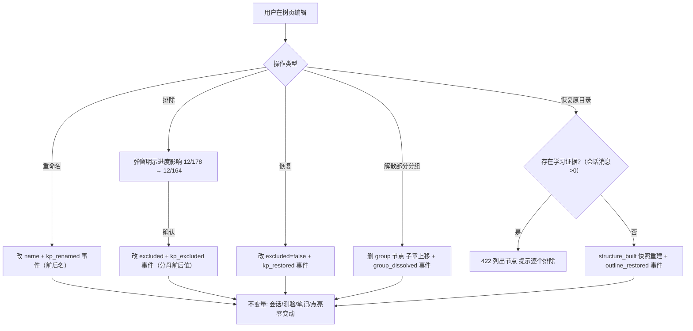
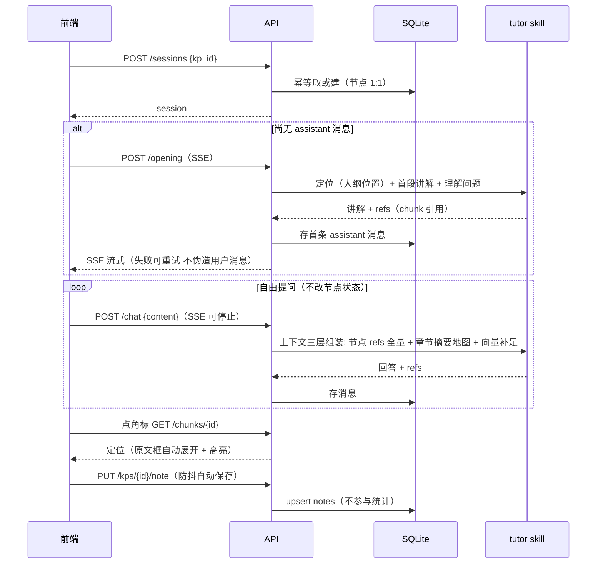
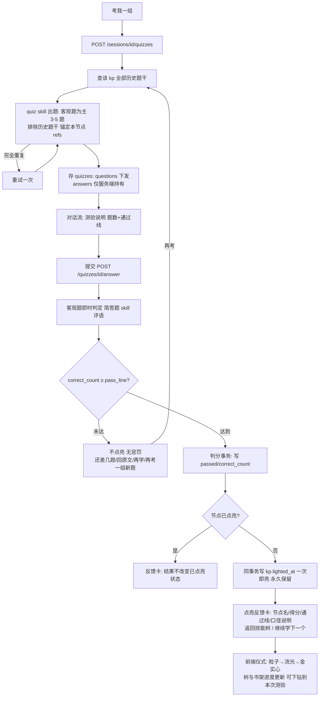
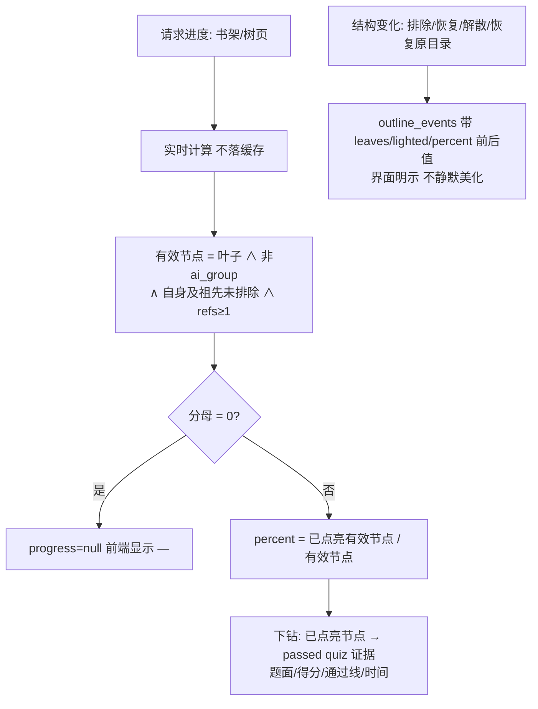

# V0.1 技术流程图

> 日期：2026-11-20｜状态：目标流程，未实施（代码已清零，随重建落地）
> 产品流程见 [需求分析](../product/需求分析.md)；本文只描述系统边界、状态与数据一致性。
> 配套：[技术方案](技术方案.md)、[数据模型](数据模型.md)、[接口设计](接口设计.md)

## 1. 导入：三阶段解耦（B1、B2-01～04）

边界：规划失败 ≠ 解析失败，分别展示与重试；embedding 先完成或后完成不改变目录结果。

## 2. 拟大纲生成与应用（B2-03，决策 #25）

不变量：章不可删、不跨章合并、group 仅连续章节区间、失败不留半次合并、正文逐字不进上下文。

## 3. 目录编辑与证据保留（B2-05，决策 #6/21）

手动拆分、合并、移动、新增节点不在本版（决策 #21，见 [后续候选/学习增强](../后续候选/学习增强.md)）。

## 4. 学习会话（B3-01～04）

## 5. 测验与点亮（B4，核心闭环）

通过线生成时已定、判分只比对不重算；打开会话、阅读、自由提问、未通过测验都不写 `lighted_at`（B4-03 反例）。

## 6. 点亮进度计算（B5-01）

## 7. 状态归属表

| 状态 | 落点 | 说明 |
|---|---|---|
| 正文解析 | `sources.parse_status` | pending / parsing / parsed / failed |
| 目录规划 | `studies.outline_status` + `outline_error` | 与 parse_status 分别展示分别重试 |
| 结构变化 | `outline_events` | 识别 / AI 规划 / 用户编辑全审计 |
| 节点学习态 | 派生：`lighted_at` + 会话消息 | 未学 / 学习中 / 已点亮，不落字段 |
| 点亮 | `knowledge_points.lighted_at` | 一次写入永久保留 |
| 会话内容 | `messages` / `quizzes` | 对话流按 created_at 合并渲染 |
| 服务配置 | `settings` | 密钥 Fernet 加密，响应只出掩码 |
| AI 用量 | `usage_days` | 写入失败不静默吞掉 |
