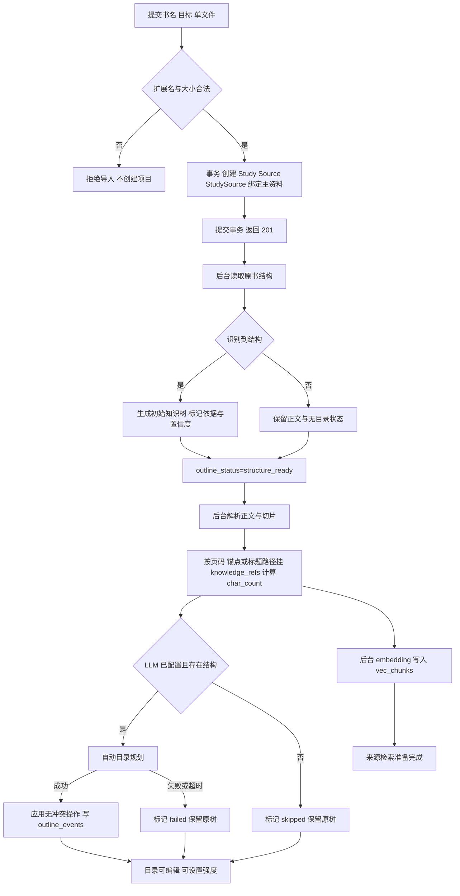
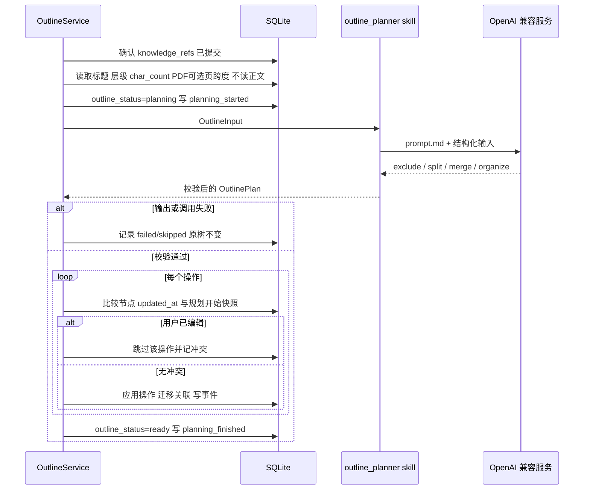
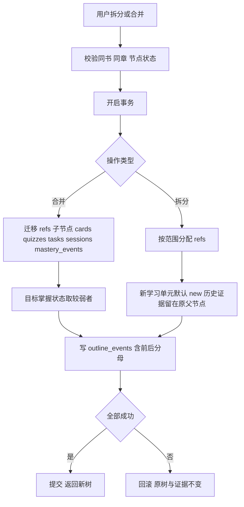
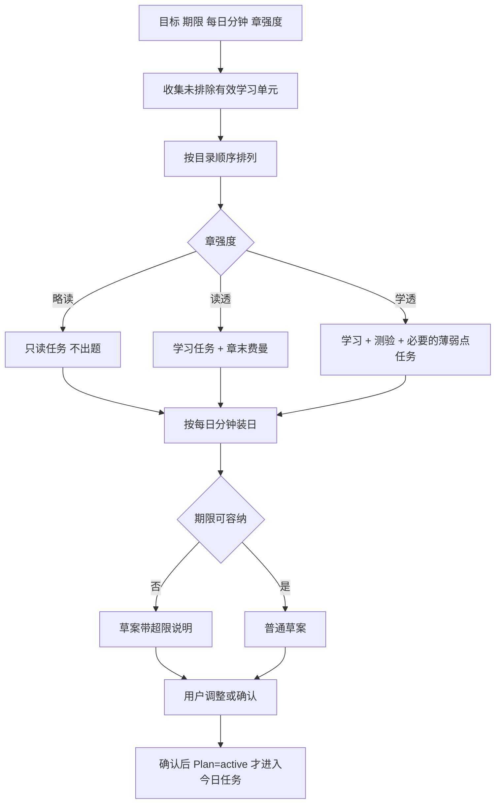
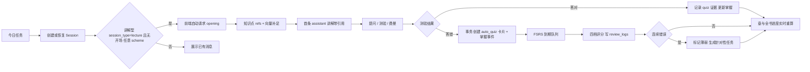
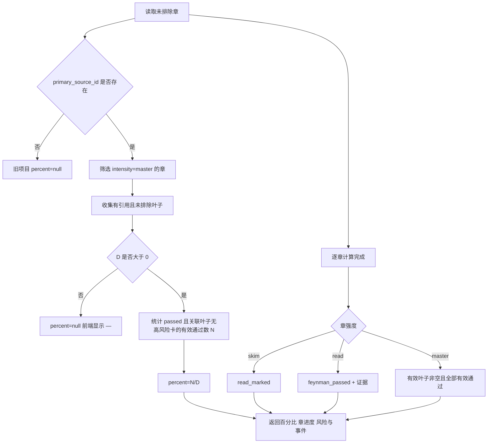
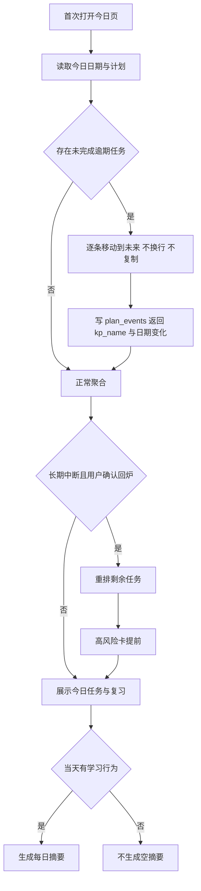

# V0.2 技术流程图

> 日期：2026-11-20｜状态：目标流程，未实施
> 产品流程见 [需求分析](../product/需求分析.md)；本文只描述系统边界、状态与数据一致性。

## 1. 导入：结构与正文解耦

关键边界：

- 项目创建事务提交后才运行后台任务；
- 结构树不依赖正文向量，也不依赖 LLM；
- `knowledge_refs` 提交后才触发和应用 AI 规划，禁止拆分合并尚未挂引用的节点；
- embedding 与 AI 规划可并行，任一先完成都不等待另一个；
- AI 规划失败与正文解析失败是两种状态，不能互相覆盖；
- 无目录不进入全文 LLM 拆解分支。

## 2. 目录规划与应用

不变量：

- 所有操作引用现有节点 ID，应用前所需 `knowledge_refs` 必须已存在；
- 章节点不可删除，不跨章合并；
- 操作应用按事务提交，失败不得留下半次合并；
- 用户编辑优先于后台较晚返回的 AI 结果。

## 3. 目录编辑与证据保留

禁止路径：删除原资料全部知识点 → 级联删除卡片与证据 → 重新生成。这条路径与新目录规划、手动编辑均不兼容。

## 4. 计划生成与强度约束

依赖推断不参与默认排序；手动新增任务同样在 service 层校验强度。

## 5. 学习、错题成卡与复习回流

任务完成、知识点通过与章完成是三个不同状态，不能在一个“完成”动作里混写。

## 6. 全书进度计算

卡片风险与掌握状态变化时，关联叶子同时退出全书分子并阻断章完成；只有目录和强度变化写 `outline_events`，高频复习波动不写结构事件。

## 7. 惰性督促与中断恢复

## 8. 状态归属

| 状态 | 事实源 | 不存放在哪里 |
|---|---|---|
| 正文解析 | `sources.parse_status/error` | 不写到目录规划错误 |
| 目录规划 | `studies.outline_status/error` | 不用正文是否向量化代替 |
| 目录与强度变化 | `outline_events` | 不混入掌握证据 |
| 计划调整 | `plan_events` | 不覆盖原始历史 |
| 掌握变化 | `mastery_events` | 不用自评字段代替 |
| 复习历史 | `review_logs` | 编辑卡片不改历史 |
| 学透百分比 | 实时查询计算 | 不落缓存列 |
